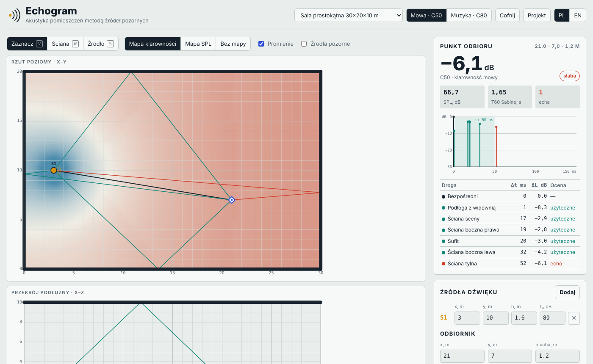

# Echogram

**Interaktywny symulator akustyki pomieszczeń metodą źródeł pozornych — działa w przeglądarce.**
*Interactive room-acoustics simulator using the image-source method — runs in the browser.*

🔗 **Demo na żywo / Live demo:** [frau-li.github.io/echogram](https://frau-li.github.io/echogram/)

---

## O projekcie

Echogram to rozwinięcie programu, który napisałam w ramach pracy licencjackiej *„Problem modelowania akustyki pomieszczeń z wykorzystaniem analizy danych”* (Collegium Da Vinci, Poznań 2023). Oryginał był aplikacją desktopową; nowa wersja działa w całości w przeglądarce, bez instalacji i bez serwera.

Program pozwala narysować salę (rzut i przekrój), ustawić źródła dźwięku i słuchacza, dobrać materiały ścian — i od razu zobaczyć, jak dźwięk dociera do każdego miejsca na widowni.

## Funkcje

- **Edytor geometrii** — rysowanie ścian na rzucie poziomym i przekroju, przyciąganie do siatki, przeciąganie źródeł i odbiornika.
- **Mapa klarowności C50 / C80** dla mowy i muzyki oraz **mapa poziomu dźwięku (SPL)** dla całej sali.
- **Wykrywanie ech** — odbicia spóźnione i zbyt głośne oznaczane na czerwono.
- **Reflektogram** — wykres czasu przyjścia i poziomu każdego odbicia z krzywą zaniku pogłosu.
- **Czas pogłosu T60** wg wzoru Sabine’a.
- **Biblioteka materiałów** (beton, drewno, zasłony, panele akustyczne, widownia…) z edycją współczynnika pochłaniania α.
- Kilka sal przykładowych (prostokątna, wachlarzowa z reflektorem, rotunda z efektem ogniskowania).
- **Import projektów `.pak`** z oryginalnej wersji z 2023 r. oraz zapis/odczyt w JSON.
- Interfejs **PL / EN**, tryb jasny i ciemny, cofanie zmian (Ctrl+Z).

## Model obliczeniowy

- Fala bezpośrednia i odbicia pierwszego rzędu wyznaczane **metodą źródeł pozornych**, z kontrolą widoczności (czy punkt odbicia leży na ścianie i czy nic nie zasłania drogi).
- Poziom: `L = L₀ − 20·lg r` (bezpośredni), `L = L₀ − 20·lg r′ + 10·lg(1 − α)` (odbity).
- Energia późna: odbicia spóźnione + pogłos statystyczny wg zrewidowanej teorii Barrona.
- Klarowność: `C = 10·lg(E₀…t₀ / E_t₀…∞)`, t₀ = 50 ms (mowa) lub 80 ms (muzyka).
- Echo: odbicie później niż t₀ i słabsze od najsilniejszego dźwięku o mniej niż 10 dB.

Model jest geometryczny i uśredniony pasmowo — służy do szybkiego porównywania wariantów sali, a nie do odbioru akustycznego.

## Technologie

Czysty **HTML + CSS + JavaScript** (Canvas 2D, SVG), jeden plik, zero zależności i zero serwera.

## Uruchomienie

Otwórz [demo](https://frau-li.github.io/echogram/) albo pobierz `index.html` i otwórz go w przeglądarce.

---

## 🇬🇧 English

Echogram grew out of my bachelor’s thesis on modelling room acoustics with data analysis (Collegium Da Vinci, 2023). Draw a hall in plan and section, place sound sources and a listener, assign wall materials, and instantly see speech/music clarity (C50/C80) and SPL maps across the room, flagged echoes, a reflectogram and Sabine reverberation time. It uses the image-source method with visibility checks plus Barron’s revised theory for the reverberant tail. Single-file vanilla JS, no dependencies, works offline. It also imports project files from the original 2023 desktop version.

---

Autorka / Author: **[FrauLi](https://github.com/Frau-Li)**
